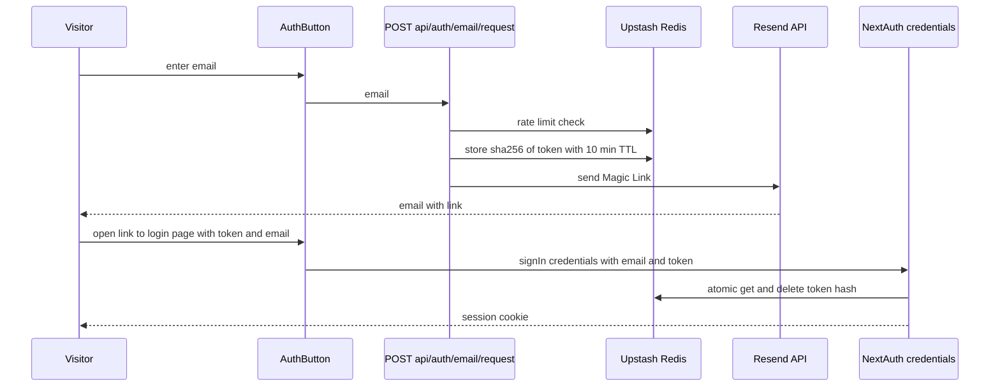

# Email Magic Link Login

Feature Name: email-magic-link-login
Updated: 2026-11-07

## Description

Adds passwordless email login to the existing NextAuth v4 setup (JWT sessions, Upstash Redis storage, Vercel Node.js runtime). The flow uses a custom token store in Redis and a NextAuth `CredentialsProvider` that exchanges a verified token for a session. This avoids the NextAuth `EmailProvider`, which requires a database adapter and conflicts with the current adapter-free JWT design.

## Architecture

Design decisions:

- Credentials provider with a token, not a password: the token is the proof of mailbox ownership.
- Link opens a page of the site (not an API URL), so mail scanners that prefetch links cannot consume the token; the token is consumed only when the page submits it through `signIn`.
- Redis `GETDEL` makes consumption atomic and single-use.
- Resend is called through `fetch`, which works on Vercel and on Cloudflare Workers.

## Components and Interfaces

| Component | Path | Responsibility |
|-----------|------|----------------|
| Token store | `lib/auth/email-token.ts` | Create token, hash with SHA-256, store with TTL, consume atomically |
| Rate limiter | `lib/auth/rate-limit.ts` | Fixed-window counters per email and per IP using `INCR` and `EXPIRE` |
| Mailer | `lib/auth/mailer.ts` | Send Magic Link through Resend HTTP API |
| Request endpoint | `app/api/auth/email/request/route.ts` | Validate email, throttle, create token, send mail, return a uniform response |
| Provider config | `app/api/auth/[...nextauth]/route.ts` | Add `CredentialsProvider` id `email`, conditional on env, reuse existing `signIn`, `jwt`, `session` callbacks |
| Login page | `app/auth/email/page.tsx` | Read token and email from the URL, call `signIn('email')`, show success or expiry |
| UI | `components/auth/AuthButton.tsx` | Email input and send button inside the login menu |
| Provider detection | `components/auth/useAuthProviders.ts` | Expose `emailEnabled` |

Environment variables:

| Name | Purpose |
|------|---------|
| `RESEND_API_KEY` | Resend API key |
| `EMAIL_FROM` | Sender address on a Resend verified domain |
| `NEXTAUTH_URL` | Base URL used to build the Magic Link |

Interfaces:

- `POST /api/auth/email/request` body `{ email: string }`, responses `200 { ok: true }`, `400`, `429`, `500`.
- NextAuth credentials `signIn('email', { email, token, redirect: false })`.

## Data Models

Redis keys (all with TTL):

| Key | Value | TTL |
|-----|-------|-----|
| `auth:email:token:{sha256(token)}` | lowercase email | 600 s |
| `auth:email:rl:addr:{sha256(email)}` | request counter | 600 s |
| `auth:email:rl:ip:{ip}` | request counter | 600 s |

User id: `email:{sha256(lowercase email) first 32 hex chars}`. The id is stable, contains no raw email, and can be placed in `ADMIN_USER_IDS`.

Managed user record reuses `ManagedUser` through `upsertManagedUser`; `email` is stored, `name` falls back to the email local part.

## Correctness Properties

- A Login Token authorizes exactly one sign-in: consumption is a single atomic `GETDEL`.
- Redis never holds a raw Login Token.
- The response of the request endpoint is identical for registered and unregistered addresses.
- The email provider is registered only when `RESEND_API_KEY`, `EMAIL_FROM`, and Redis are all configured.
- GitHub and QQ login behavior is unchanged.

## Error Handling

| Scenario | Handling |
|----------|----------|
| Invalid email | 400, form message |
| Rate limit exceeded | 429, message with retry hint |
| Resend failure | 500, uniform retry message, details in server log only |
| Redis unavailable | Provider not registered; request endpoint returns 503 |
| Token expired or used | `signIn` returns error, page shows expiry message with a resend action |
| Banned user | Existing `signIn` callback returns false |

## Test Strategy

- Unit tests for token hashing, single-use consumption, TTL expiry, and rate-limit counters using an in-memory Redis stub.
- Endpoint tests for 400, 429, uniform 200, and Resend failure paths with a mocked `fetch`.
- Manual end-to-end check on a Vercel preview with a real Resend key.
- Regression check: GitHub sign-in redirect and `/api/auth/providers` output remain unchanged.

## References

[^1]: (app/api/auth/[...nextauth]/route.ts#L20) - [NextAuth options](../../../app/api/auth/[...nextauth]/route.ts)
[^2]: (lib/user-management.ts#L60) - [upsertManagedUser](../../../lib/user-management.ts)
[^3]: (lib/db.ts) - [Upstash Redis client](../../../lib/db.ts)
